# 架构

本仓库各包、进程、线程与控制器之间的关系。图用 Mermaid 写成（GitHub 与多数 Markdown 预览直接渲染）。
图只画结构与数据流，规则的理由在各自的出处：故障处理见 [fault_handling.md](fault_handling.md)，
固件行为见 [sdk_quirks.md](sdk_quirks.md)（文中 S*/G*/F* 编号），用法见各包 README。

## 1. 系统上下文

一台机械臂对应一套 ros2_control 进程与一台法奥控制器。驱动只经三个 TCP 端口与控制器通信，
不链接厂商 SDK（`libfairino`）。

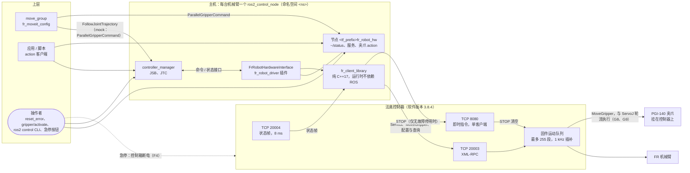

| 端口 | 方向 | 内容 | 主机侧连接 |
|---|---|---|---|
| 20003 | 请求 / 应答 | XML-RPC over HTTP/1.1 长连接 | 三条互不阻塞：`RobotApi`（配置、服务）、`ServoSender`（ServoJ 流）、`GripperSender`（MoveGripper） |
| 20004 | 控制器推送 | 状态帧（`RobotState384`，960 字节） | `StateReceiver`；控制器只服务一个客户端 |
| 8080 | 请求 / 回执 | 即时指令，驱动只用 STOP | `InstantCommandChannel`；控制器只服务一个客户端 |

## 2. 包与依赖

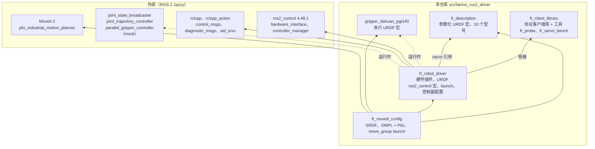

- `fr_client_library` 只依赖 C++17 与 POSIX；ament_cmake 只负责构建、安装与测试。
- `fr_robot_driver/urdf/fr_controlled.urdf.xacro` 把 `fr_description` 的机械臂宏、可选的夹爪宏与
  `fr_ros2_control.xacro` 拼成 controller_manager 读取的一份 URDF；mock 与真机只差 `<hardware>` 一节。

## 3. ROS 图（单台机械臂，真机分支）

`<ns>` 为 launch 的 `namespace`，`
` 为 `tf_prefix`。多机时每台机械臂各有一份下图，靠命名空间与
`tf_prefix` 隔离（第 10 节）。

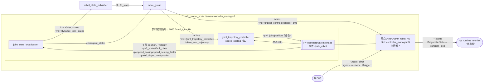

| 接口 | 真机 | mock（`mock_components/GenericSystem`） |
|---|---|---|
| 6 个关节：命令 `position`，状态 `position`、`velocity` | 插件 | 回环 |
| `
fr_status/fault_class` | 0 正常 / 1 机器人故障 / 2 急停 / 3 通信 | 恒 0（`mock_gpio_commands:=true` 时可写） |
| `
speed_scaling/speed_scaling_factor` | 1.0；夹爪忙时 0.0 | 恒 1.0（同上） |
| `
left_finger_joint`（`gripper:=pgi140`） | 只有状态接口 | 另有 `position`、`max_effort` 命令接口 |
| 夹爪 action `gripper_controller/gripper_cmd` | 插件节点提供 | `parallel_gripper_action_controller` 提供 |
| `~/status`、`~/reset_error`、`~/gripper/activate` | 插件节点提供 | 无 |

## 4. 插件内部结构

插件 `FrRobotHardwareInterface` 负责生命周期、线程与 I/O；规则判断放在不做 I/O、不读时钟的纯逻辑类里，
可脱离 ROS 和网络单独测试。

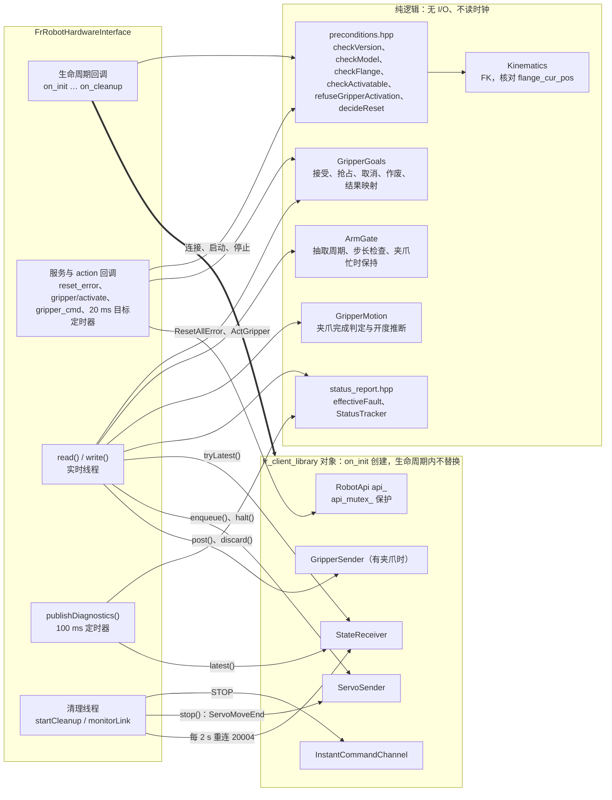

### fr_client_library 分层

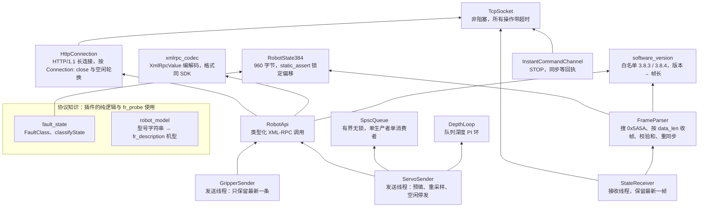

## 5. 线程模型

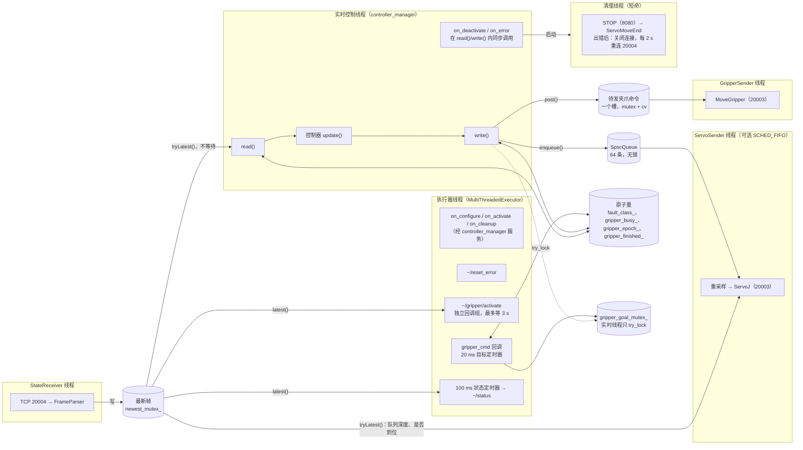

- `read()`/`write()` 从不阻塞在网络或锁上：状态用 `tryLatest()`（接收线程正在写入的那一刻沿用上一帧），
  伺服命令进无锁队列，夹爪命令进一个非阻塞的槽，目标表只 `try_lock`。
- `on_deactivate`/`on_error` 跑在实时线程上，只置标志、`halt()`；STOP、`ServoMoveEnd`、关闭连接交给清理线程，
  下一次 configure/activate 先等它结束。
- 三条 20003 连接各属一个线程，ServoJ 流不会被服务或夹爪调用阻塞。

## 6. 一个控制周期与伺服链路

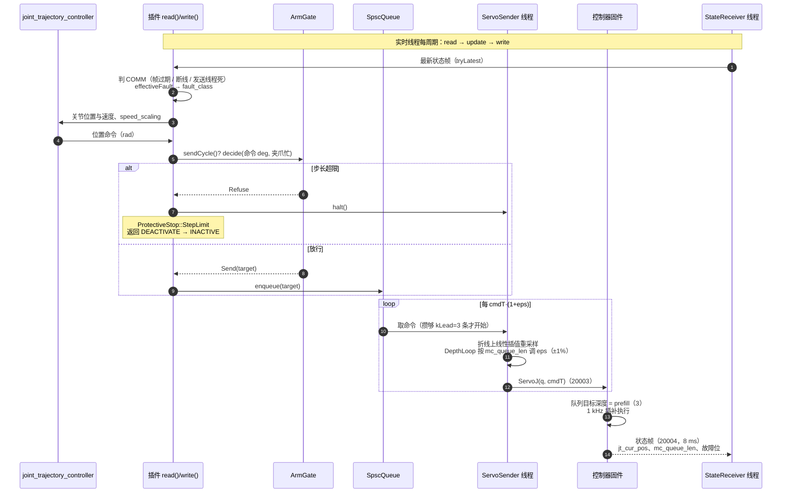

- 命令到实际运动的跟随滞后约 116–133 ms（S19），其中约 48 ms 是 `kLead` 3 条与 `prefill` 3 条的缓冲。
- 控制周期快于 cmdT 时按整数倍抽取（`ratio = update_rate × cmd_t_ms / 1000`）。
- 停发 ServoJ 不会让机械臂立即停下，固件会走完队列里的段；无故障的主动停用先发 STOP（8080）清空队列。

### ServoSender 的状态

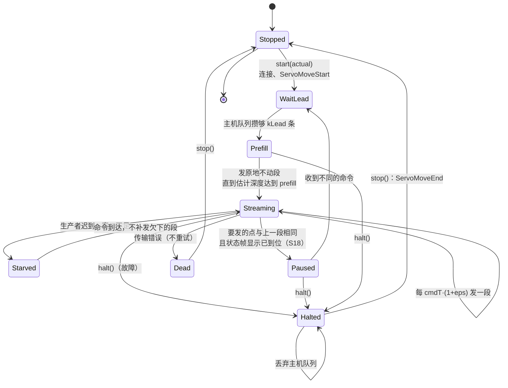

`Paused` 时控制器队列排空，`MoveGripper` 才会被执行（G8）；从 `Paused` 恢复与 `start()` 相同，先攒 `kLead` 条再预填。
`Starved` 只是等数据，不重新预填。`Dead` 由下一次 `read()` 以 `CommReason::ServoFailed` 报为通信故障。

## 7. read() / write() 决策

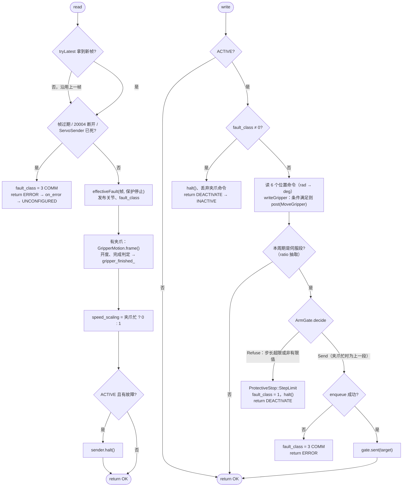

故障分级、生命周期状态机与恢复流程见 [fault_handling.md](fault_handling.md) 第二至五节。

### 生命周期回调做什么

| 回调 | 线程 | 连接与线程 | 检查（`preconditions.hpp`） |
|---|---|---|---|
| `on_init` | 主线程 | 创建全部客户端对象（不连接）与节点 `
fr_robot_hw`（服务、action、定时器） | URDF 接口与限位、参数范围、`update_rate × cmd_t_ms` 整除 |
| `on_configure` | 执行器 / 启动 | 连 20003 → 设并回读状态周期 → 启动 `StateReceiver` 等首帧 → 读负载与工具（只读）→ 连 8080 → 启动 `GripperSender` | 版本白名单、型号一致、法兰 FK 核对 |
| `on_activate` | 执行器 / launch 显式激活 | 命令置为实际位置，`ServoSender::start(actual)`，新建 `ArmGate` | 帧新鲜、无故障、已使能、法兰 FK 再核对 |
| `on_deactivate` | 实时线程 | `halt()`；清理线程：无故障时 STOP，再 `ServoMoveEnd` | — |
| `on_error` | 实时线程 | `halt()`；清理线程：`ServoMoveEnd`，关闭全部连接，之后每 2 s 只读重连 20004 | — |
| `on_cleanup` / `on_shutdown` | 执行器 | 结束清理线程，关闭全部连接 | — |

## 8. 夹爪 action（真机）

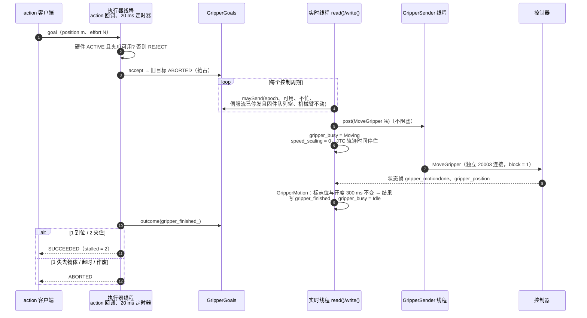

`gripper_epoch_` 在硬件激活或停用、出错、夹爪变为不可用、夹爪激活时递增，在此之前接受的目标一律作废、不再执行。
夹爪运动期间机械臂命令保持上一段（G9），夹爪完成后才放行。

## 9. 启动顺序（真机分支）

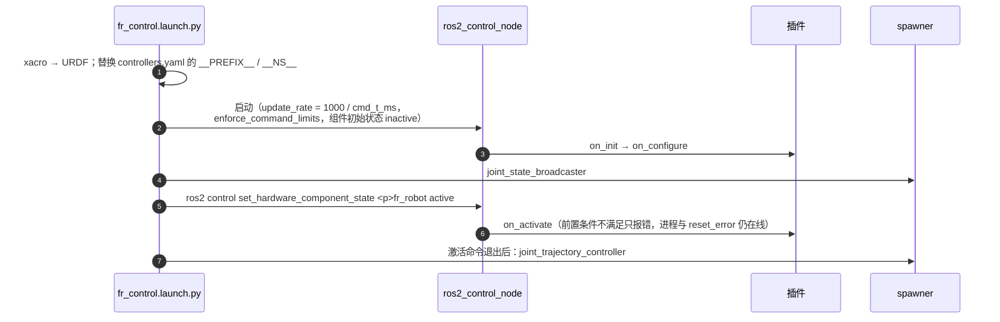

mock 分支没有显式激活这一步，同时拉起 JTC（有夹爪时加 `gripper_controller`）。让硬件先停在 `inactive` 的原因见
`fr_robot_driver/README.md`"启动顺序"。

## 10. 多机单元

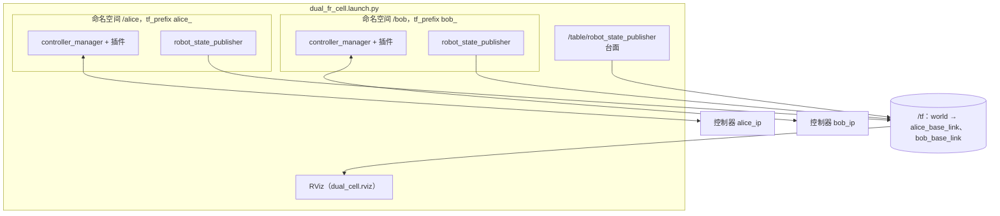

每台机械臂由 `fr_control.launch.py` include 一次：话题、服务、action 靠命名空间隔离，TF 帧与关节名靠 `tf_prefix`
隔离，各自一个 controller_manager 与插件实例，连各自的控制器。ros2_control 不做碰撞检查，双臂之间的安全靠规划层。
