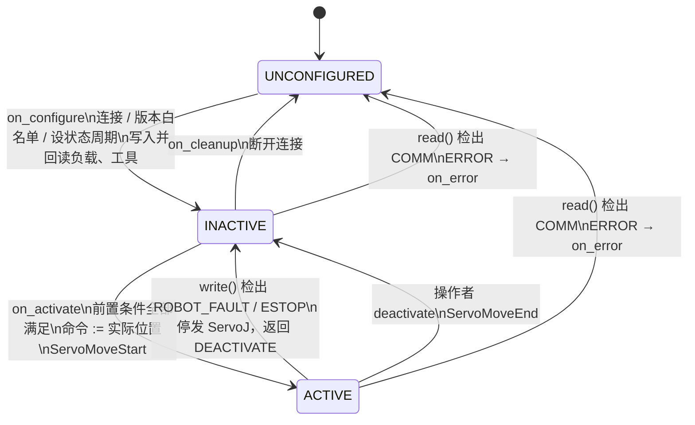

# 急停 / 故障状态管理设计（固件 3.8.4）

> 固件硬性要求：故障期间不得发送运动指令、不得自动复位、急停只能硬件重启。
> 本文定义硬件插件 `FrRobotHardwareInterface` 的故障分级、检测、状态机与恢复流程。
>
> - 固件事实见 [sdk_quirks.md](sdk_quirks.md) 第六节（F1–F5）
> - ros2_control 行为以 `references/ros2_control`（4.48.1）源码为准
> - 来源标记沿用：🔍 源码确认　📋 维护者确认/仿真器实测　❓ 待真机验证

---

## 一、ros2_control 提供的机制（只用这些，不自造框架）

| 机制 | 行为 | 源码 |
|---|---|---|
| `write()` 返回 `DEACTIVATE` | 组件 → **INACTIVE**（不走 `on_error`）；占用其命令接口的控制器被停用 | `resource_manager.cpp:2613` |
| `read()`/`write()` 返回 `ERROR` | 调 `on_error()`：SUCCESS → **UNCONFIGURED**，FAILURE → FINALIZED；接口全部不可用；相关控制器停用 | `resource_manager.cpp:2507/2605`、`hardware_component.cpp:241` |
| `read()` 返回 `DEACTIVATE` | **等同 ERROR**（只多一条 WARN）——故障判定不能放在 `read()` 里返回 DEACTIVATE | `resource_manager.cpp:2505` |
| INACTIVE 组件 | **仍调用 `read()`，不调用 `write()`** → 状态照常发布，运动指令从机制上停发 | `hardware_component.cpp:380/420` |
| 手动恢复 | `ros2 control set_hardware_component_state <name> active`；控制器需重新 `switch_controllers` | `SetHardwareComponentState.srv` |
| 命令限幅 | controller_manager 参数 `enforce_command_limits`（**Jazzy 默认 false**），按 URDF 限位饱和 | `controller_manager_parameters.yaml` |

ros2_control **没有**急停/保护停止/机器人模式的概念，也不负责安全。安全由固件与安全控制器保证，
驱动的职责是：**及时停发、如实上报、不擅自恢复**。

## 二、故障分级

| 级别 | 含义 | 插件动作 | 恢复 |
|---|---|---|---|
| **COMM**（通信故障） | 与控制器的数据链路不可信 | `read()` → `ERROR` → `on_error` → UNCONFIGURED | 控制器在线后，操作者 configure → activate |
| **ROBOT_FAULT**（机器人故障） | 超速、超限、碰撞、安全停止、掉使能等（F1） | 立即停发 ServoJ；`write()` → `DEACTIVATE` → INACTIVE | **操作者显式**复位后重新激活（F3） |
| **ESTOP**（急停） | 急停拍下 | 同 ROBOT_FAULT，且**拒绝一切复位与激活** | 只能硬件重启（F4）；重启导致断线 → 转 COMM |

优先级：COMM > ESTOP > ROBOT_FAULT（链路不可信时，状态帧里的一切都不可信）。

## 三、检测条件

### COMM（在 `read()` 中判定）

| 条件 | 依据 |
|---|---|
| 超过 N 个状态周期无新帧（`frame_cnt` 未变化，初值 N = 3，周期默认 8 ms 📋） | R1、R5（仿真器上 `frame_cnt` 每帧 +2，只能判"变没变"） |
| 帧头 ≠ `0x5A5A`、`data_len < 953`、校验和错误 | V2、R4 |
| 状态全零 | R3（SDK 出错时会清零；自研接收器也要防御） |
| 软件版本不在白名单（configure 阶段） | 第一节"版本识别" |
| XML-RPC 调用超时或连接失败（非实时线程中发生，置标志，由 `read()` 上报） | C3、C4 |

### ROBOT_FAULT / ESTOP（在 `write()` 中用 `read()` 缓存的最新状态判定）

| 字段（3.8.4 偏移） | 判定 | 级别 | 仿真器正常值 📋 |
|---|---|---|---|
| `EmergencyStop` (549, u8) | `!= 0` | ESTOP | 0 |
| `main_code` (7, i32) / `sub_code` (11, i32) | `main_code != 0` | ROBOT_FAULT | 0 / 0 |
| `collisionState` (559, u8) | `!= 0` | ROBOT_FAULT | 0 |
| `safety_stop0_state` / `safety_stop1_state` (564/565, u8) | `!= 0` | ROBOT_FAULT | 0 / 0 |
| `rbtEnableState` (771, i32) | `!= 1`（❓ 编码以真机为准） | ROBOT_FAULT | 1 |
| `robot_state` (6, u8) | `== 4`（拖动示教中） | ROBOT_FAULT | 1 |

- ❓ `robot_mode`（15, u8；0 自动 / 1 手动，仿真器当前为 1）对 ServoJ 的影响待验证，暂不作为故障条件
- ❓ SI0/SI1 安全停止是否可由 `ResetAllError` 清除待验证
- 错误码 `main_code`/`sub_code` **原样导出**，不在驱动内翻译（含义查官方文档 `references/fr_documentation`，tag `3.8.4`）

## 四、状态机

### 各回调要点

| 回调 | 做什么 | 不做什么 |
|---|---|---|
| `on_configure` | 建连接；`GetSoftwareVersion` 取软件版本对白名单；`SetRobotRealtimeStateSamplePeriod` 并回读；按参数写负载/工具并回读校验；启动状态接收线程，等到首个有效帧 | 不使能、不复位 |
| `on_activate` | 检查前置条件（无 ESTOP、无 ROBOT_FAULT、已使能、状态新鲜）；**用实际关节位置初始化命令**；`ServoMoveStart`（S6：按 API 约定调用，不依赖其空语义） | 条件不满足直接返回 FAILURE，**不尝试复位或使能** |
| `read()` | 取最新状态（无阻塞）；COMM 判定；更新关节与 GPIO 状态接口 | 不调用任何 XML-RPC |
| `write()` | 先做 ROBOT_FAULT/ESTOP 判定，命中则停发并返回 DEACTIVATE；否则做步长检查后把命令交给发送线程 | 不在 RT 线程里做网络 I/O |
| `on_deactivate` | 停发；`ServoMoveEnd`（S6） | 不把"已调用 ServoMoveEnd"当作已停止的依据 |
| `on_error` | 停发；尽力而为地关闭连接（带超时，不得阻塞） | 不复位、不重连；返回 SUCCESS → UNCONFIGURED |

**实现要点（已在仿真器验证）**：

- `on_deactivate` / `on_error` 由 ros2_control 在 `ResourceManager::write()/read()` **内部同步**调用，即跑在实时线程上：
  回调里只置标志、`halt()`，网络部分（`STOP`、`ServoMoveEnd`、关连接）交给一个短命的清理线程，下一次
  `on_configure`/`on_activate` 先等它结束
- `on_activate` 可能在**第一次 `read()` 之前**被调用（控制器管理器启动时）：状态直接取自 `StateReceiver::latest()`
  （加锁、任意线程可用）；实时线程上的 `read()` 用不等待的 `tryLatest()`
- 启动时若让控制器管理器自己激活硬件，激活失败会使 ros2_control **直接 abort**（连同 `reset_error` 服务）。
  所以真机分支让硬件先停在 `inactive`，由 launch 显式激活（`hardware_components_initial_state`）
- 控制周期快于 cmdT 时按整数倍抽取（`ratio = update_rate × cmdT`），不按时间累加（周期抖动会造成丢周期）

**F2 注意**：检出故障时可能有一帧 ServoJ 已在途，它返回错误属预期，记 DEBUG 日志，不得再升级处理。

## 五、恢复流程（全部由操作者发起，驱动绝不自动执行 — F3）

**ROBOT_FAULT**：

1. 查看 GPIO 状态 / 话题中的 `main_code`、`sub_code`，排除故障原因
2. 调用复位服务 `<ns>/<tf_prefix>fr_robot_hw/reset_error`（`std_srvs/Trigger`；由插件挂在控制器管理器的执行器上，
   **用独立的 XML-RPC 连接**调 `ResetAllError`，不与伺服连接混用）
   - ESTOP 时**拒绝**；COMM 故障时拒绝
3. 等待状态帧中故障位清零；`ResetAllError` 不会掉使能（F5），但仍以 `rbtEnableState` 为准
4. `ros2 control set_hardware_component_state fr_robot active`
5. 激活即以**实际关节位置**重新 `ServoSender::start(actual)`（新的伺服会话，清空主机队列并重新预填；故障后固件队列大概率是空的），
   之后的目标从实际位置起用斜坡，不能一步跳回（sdk_quirks S11）

> 第 2–5 步可以后续合并为一个 `recover` 服务，但**触发仍必须来自操作者**。

**ESTOP**：硬件重启控制器 → 链路断开，插件转 COMM → UNCONFIGURED → 控制器上线后由操作者
configure → activate。

**COMM**：确认控制器在线 → configure → activate → 激活控制器。暂不做自动重连。

## 六、预防（从 ROS 侧减少触发超速/超限）

- controller_manager 打开 `enforce_command_limits: true`，限位与速度来自 `fr_description` 的 `joint_limits.yaml`
- 插件内步长检查：单周期 `|Δq| > v_max · dt` 的命令**拒绝下发**并判 ROBOT_FAULT（防御控制器/规划层异常）
- 固件负载、工具配置与实物一致，避免误报碰撞（见第七节）
- **`ServoJ` 不受全局速度/加速度限制，只有固件最基本的角速度、电流与限位保护**（sdk_quirks S14）：`SetSpeed` 不能代替上面两条
- **固件里最多排着 255 条运动指令**（S15）：停发 ServoJ 不会立刻停下，已入队的会走完（8 ms 周期下最长约 2 s）。
  故障类（ROBOT_FAULT / ESTOP）由固件自己停；`ServoSender::halt()` 只停发并丢弃主机队列，**非故障的主动停下（如 deactivate）应先发 `STOP`（8080）清空固件队列**，
  再 `ServoMoveEnd`——仿真器上 `STOP` 约 100 ms 内停稳且队列归零（S16）；真机 ❓

## 七、状态上报（GPIO 状态接口）

一个 `<gpio name="${tf_prefix}fr_status">`，全部为 state interface（double）：

| 接口 | 来源 |
|---|---|
| `fault_class` | 0 正常 / 1 ROBOT_FAULT / 2 ESTOP / 3 COMM |
| `estop`、`safety_stop0`、`safety_stop1`、`collision` | 对应字段 |
| `main_code`、`sub_code` | 原样 |
| `enabled`、`robot_mode`、`robot_state` | 对应字段 |
| `servo_queue_len` | 状态帧 `mc_queue_len`（555）：固件运动队列占用；稳态应约 0–2，持续增长 = 发送快于消费（S16） |

- 由 broadcaster 发布为话题，供上层 / HMI 使用
- **mock 对等**：mock 分支声明同名接口；`mock_gpio_commands:=true` 给它们加回环命令接口，用来演练上层的故障处理
  （只演练读侧：状态机本身由 `fr_robot_driver/test` 的假控制器测试覆盖）

## 八、固件侧坐标系配置（只为安全功能，不用于运动指令）

运动指令只发关节角，运动学全部用我们的 URDF / MoveIt。但固件的安全功能依赖其自身配置：

| 固件配置 | 影响 | 做法 |
|---|---|---|
| 负载 `SetLoadWeight` / `SetLoadCoord` | 碰撞检测、动力学补偿；错了会误报碰撞或漏检 | configure 时按参数写入并回读 |
| 工具 `SetToolCoord` | TCP 限速、安全平面、示教器显示 | 与 `tool0 → TCP` 一致 |

**型号检查与法兰一致性检查（configure 时做，activate 时法兰检查再做一次）**：

- **型号**：`GetSoftwareVersion` 返回的型号字符串（如 `FR5-V1-002(V6.0)`）按官方手册的型号表映射到 `fr_description`
  机型（`fr_client_library/robot_model.hpp`），必须和 URDF 所用机型（`model` 参数）一致，否则 configure 失败。
  表里没有的型号（V4.0/V5.0 代、Mirror、ART、FR10YD、FR3-C）视为未知，`allow_unknown_model` 才放行
- **法兰**：状态帧 `flange_cur_pos` 与我们对同一帧 `jt_cur_pos` 的 FK（`fr_robot_driver/kinematics.hpp`，参数来自
  `default_kinematics.yaml`）比较，位置默认 ≤ 10 mm、姿态 ≤ 1°（姿态按旋转矩阵比较，不受欧拉角 ±180°、
  奇异点歧义影响）。能发现型号选错、关节零位/正负号约定错误、安装方式不同
- **约定（仿真器 6 个位形实测，FK 与 `flange_cur_pos` 位置差 ≤ 0.25 mm、姿态差 ≤ 0.1°）**：`flange_cur_pos`
  单位 **mm / deg**，基坐标系就是 URDF 的 `base_link`（无额外旋转），姿态 `R = Rz(rz)·Ry(ry)·Rx(rx)`，
  法兰 = `wrist_3` 坐标系沿 z 偏移 `flange_offset`
- 容差故意放宽：只用来发现粗大错误。真机可能有标定补偿，需实测后收紧 ❓；非正装（侧装/倒装）时基坐标系的
  表示是否变化 ❓

## 九、待验证（❓ 汇总）

- [ ] `rbtEnableState` 编码（仿真器使能时为 1）
- [ ] `robot_mode` 手动/自动对 ServoJ 的影响
- [ ] SI0/SI1 安全停止能否由 `ResetAllError` 清除
- [ ] 伺服流中断（停发 ServoJ）时固件的行为（S4；仿真器见 S16）
- [ ] 急停下插件的行为（仿真器无法注入急停：只有假控制器测试覆盖；`reset_error` 拒绝、硬件 → inactive）
- [ ] `comm_timeout_periods`（默认 3 个状态周期 = 24 ms）在真机网络上是否会误报 COMM
- [ ] 真机上的队列行为：255 条满时 `ServoJ` 是否同样阻塞、`mc_queue_len` 是否同样反映占用、`STOP` 是否同样清空队列（S16）
- [ ] 真机上 FK 与 `flange_cur_pos` 的实际偏差（标定补偿）、非正装时的基坐标系，据此收紧容差
